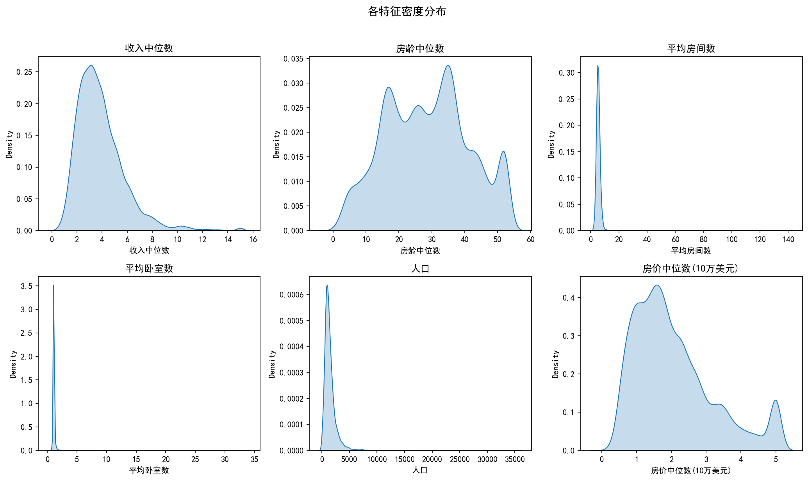
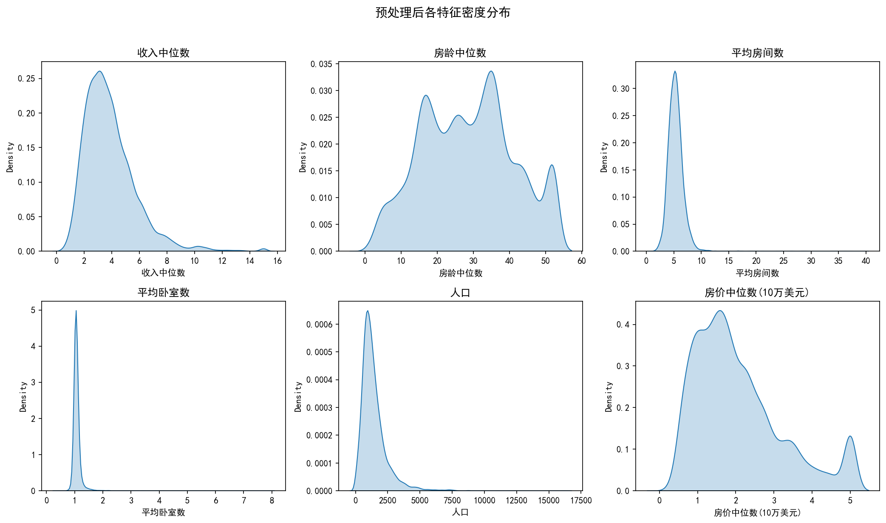
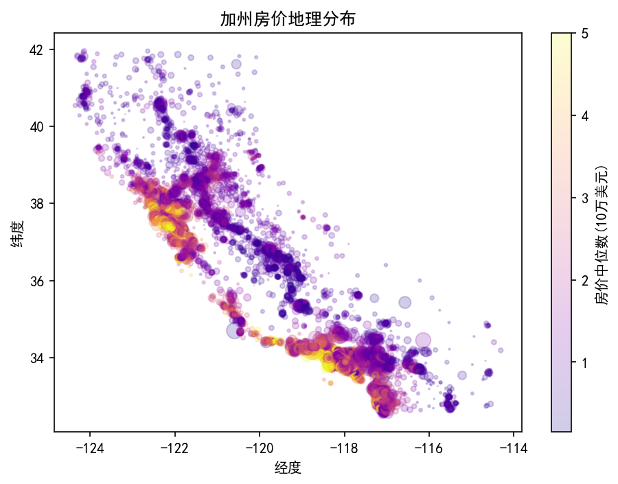
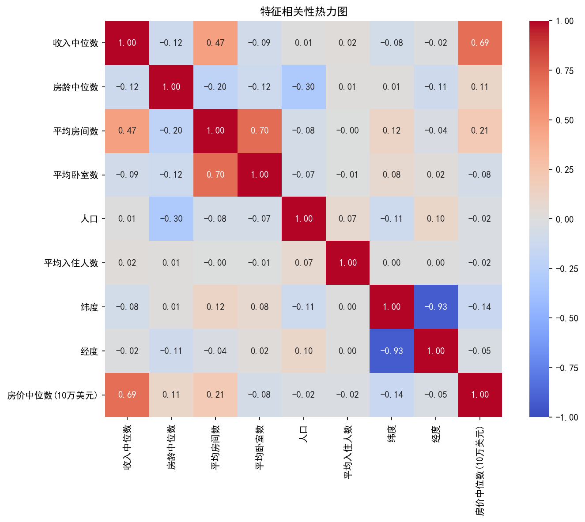
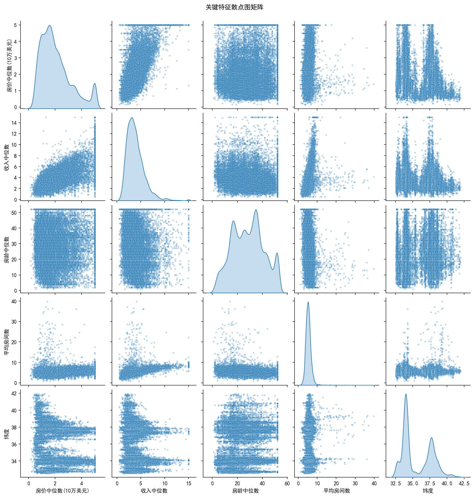

# 加州房价探索性数据分析

## 项目简介

使用 scikit-learn 内置 California Housing 数据集，练习特征分布检查、极端值处理、地理可视化、相关性热力图和散点图矩阵。

[浏览网页项目说明](https://baishi-oss.github.io/urban-data-analysis-portfolio/projects/california.html)

## 文件

```text
california-housing/
├─ analysis.ipynb
└─ figures/
```

## 可视化成果

### 1. 原始特征分布

平均房间数、平均卧室数和人口存在明显长尾，说明在比较变量关系前需要先检查极端值。



### 2. 预处理后的特征分布

过滤少量极端记录后，主要分布区间更清晰。这里的处理用于改善探索性图表的可读性，不代表适用于所有预测任务。



### 3. 房价地理分布

较高房价值在旧金山湾区、洛杉矶及部分沿海区域更集中，说明地理位置是理解房价差异的重要背景。



### 4. 特征相关性

当前样本中，收入中位数与房价中位数的线性相关系数约为 0.69；平均房间数与平均卧室数约为 0.70，提示二者包含重叠信息。



### 5. 关键特征散点图矩阵

散点矩阵用于检查趋势、离群点和目标值上限效应。房价在 5 附近的集中现象来自该数据集的目标值截断上限。



## 运行

```powershell
pip install -r ..\..\requirements.txt
jupyter notebook analysis.ipynb
```

首次执行 `fetch_california_housing()` 时可能需要联网下载数据。图片输出到 `figures`。

## 处理说明

为了改善探索性图表的可读性，Notebook 过滤平均房间数大于 80、平均卧室数大于 8、人口大于 20,000 的极端记录。这一规则只用于当前可视化，不代表正式建模的最佳处理方式。

## 局限

- 当前成果不包含预测模型或模型评估。
- 相关性不代表因果关系。
- 房价目标值存在截断上限。
