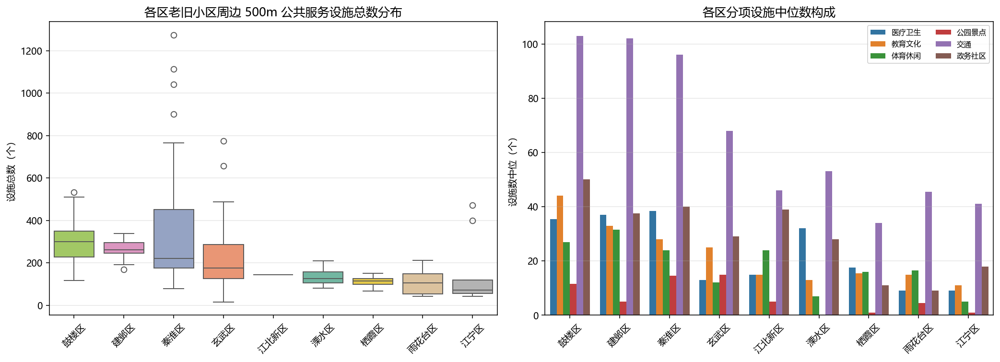
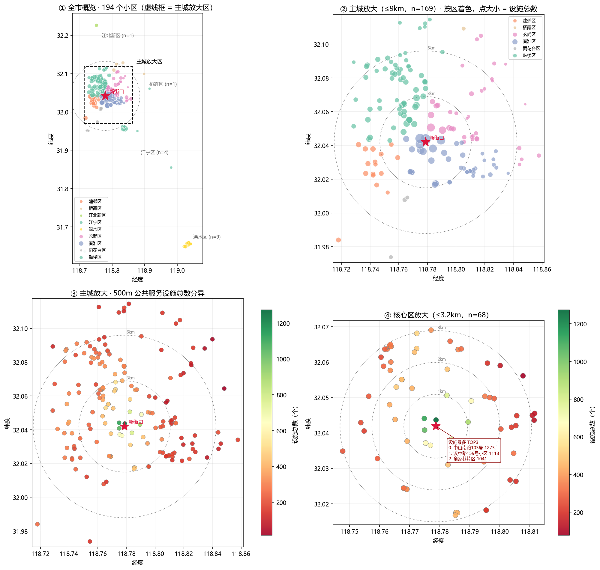
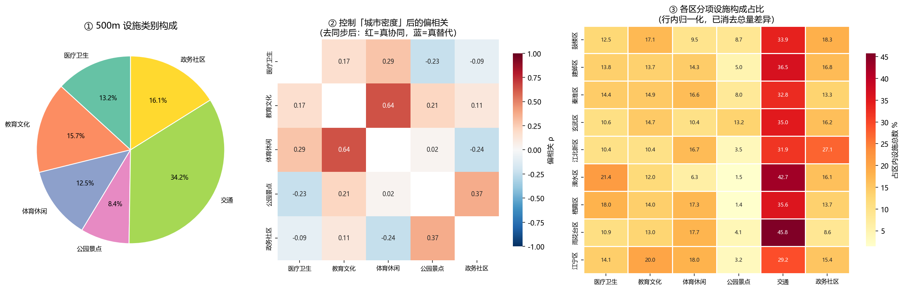
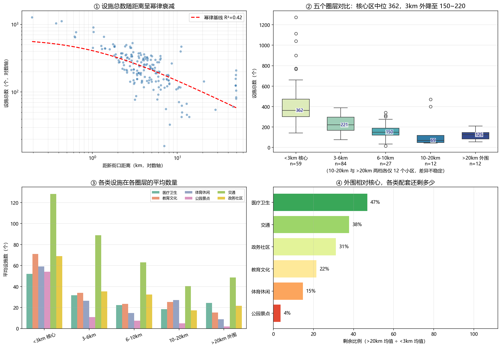
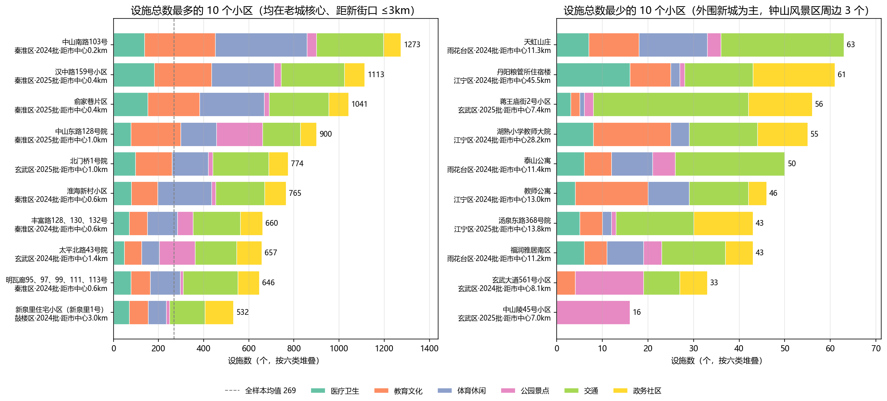
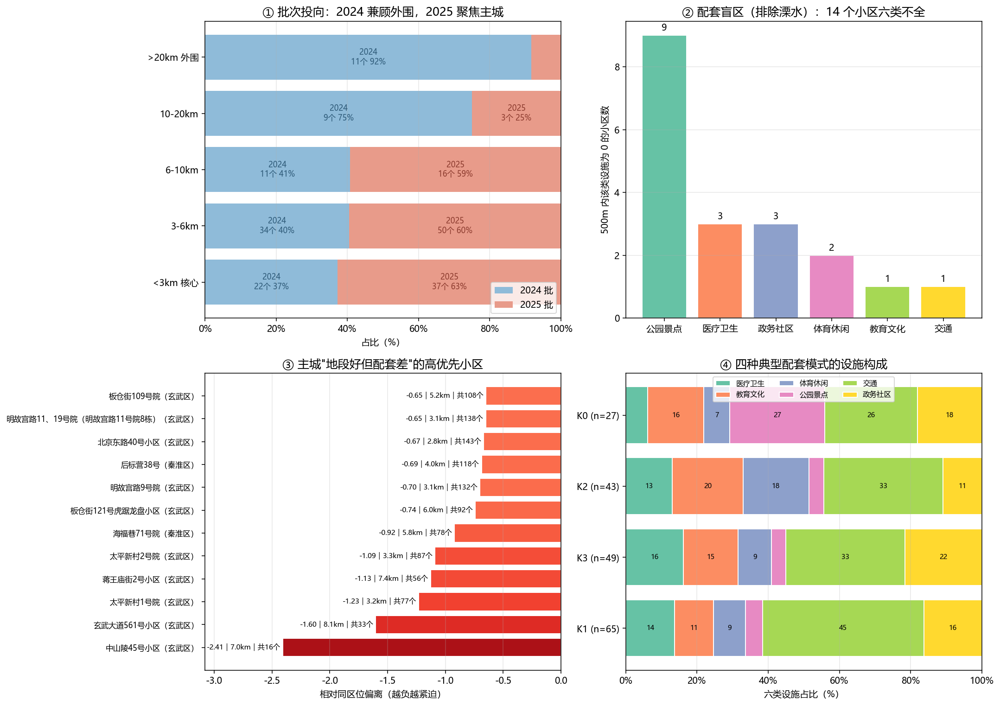
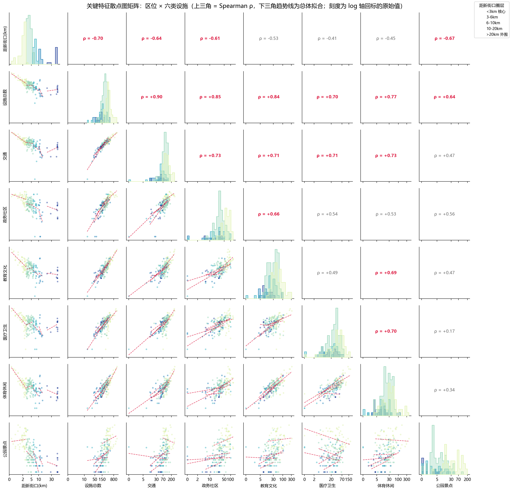

# 南京老旧小区周边公共服务分析

## 项目简介

项目以南京 2024—2025 年老旧小区改造名单为基础，分析小区周边 500 米范围内六类公共服务设施的总量、结构、空间差异和潜在配套盲区。

[浏览网页项目说明](https://baishi-oss.github.io/urban-data-analysis-portfolio/projects/nanjing.html)

## 目录

```text
nanjing-public-service/
├─ data/
│  └─ analysis_base.csv       清洗后的公开分析底表
├─ figures/                   七张分析成果图
├─ notebooks/
│  └─ analysis.ipynb          可视化与统计分析
└─ path_config.py             相对路径与环境变量示例
```

## 主要分析

- 行政区之间的设施总量和类别差异。
- 全市、主城和核心区的分级空间分布。
- 六类设施构成与控制密度后的偏相关。
- 设施数量随距新街口距离变化的圈层差异。
- 设施总数极值小区及其类别构成。
- 改造批次、配套盲区、同区位优先名单和配套模式聚类。
- 区位与设施关键特征的散点矩阵诊断。

## 可视化成果

### 1. 区域差异

不同区的小区周边设施总量和类别构成存在差异。箱线图保留区内离散程度，分项中位数用于判断差异主要来自哪些设施类别。



### 2. 空间分布

采用“全市—主城—核心区”三级放大，同时保留全市位置关系和中心城区内部差异，点的视觉变量用于表达 500 米设施总量。



### 3. 设施结构

交通设施约占六类设施总量的 34.2%。图中还比较了控制城市密度代理变量后的类别偏相关，以及各区内部的设施构成。



### 4. 区位衰减与圈层差异

设施总量随距新街口距离整体下降，幂律拟合的 R² 为 0.42。核心区样本设施总数中位数为 362，3—6 公里和 6—10 公里圈层分别为 221 和 150；远距离圈层样本较少，因此仅作探索性比较。



### 5. 极值小区

设施总数较高的样本集中于老城核心，低值样本以外围新城为主。堆叠条形图同时呈现总量差距和六类设施的结构差距。



### 6. 配套盲区与优先样本

在排除设施数据不准确的溧水样本后，有 14 个小区在 500 米内未覆盖全部六类设施，其中公园景点缺失最常见。优先样本强调相对同区位基线偏低，而非简单选择绝对值最低者。



### 7. 关键特征散点矩阵

散点矩阵用于复核区位和设施数量之间的趋势、离群点与分组结构，作为相关系数和聚类结果之外的视觉诊断。



## 运行

从本项目目录或其子目录启动 Jupyter：

```powershell
pip install -r ..\..\requirements.txt
jupyter notebook notebooks\analysis.ipynb
```

Notebook 会自动向上寻找 `data/analysis_base.csv`，生成图表到 `figures`。

## API 与路径安全

- 公开分析 notebook 不需要 API 密钥。
- API 相关流程只通过环境变量读取密钥，示例见根目录 `.env.example`。
- `.env`、`API.env`、虚拟环境和编辑器配置均被 `.gitignore` 排除。
- 所有公开代码使用项目相对路径，不依赖 `C:`、`D:` 或 `E:` 等本机盘符。
- 如果真实密钥曾进入 Git 历史，应在服务商后台轮换；仅加入 `.gitignore` 不能清除历史。

## 数据口径与局限

设施数量来自地图平台 POI，不能直接代表设施质量、服务容量、真实步行可达性或居民满意度。分析结果用于学习和探索，不替代政府统计或正式规划评估。
